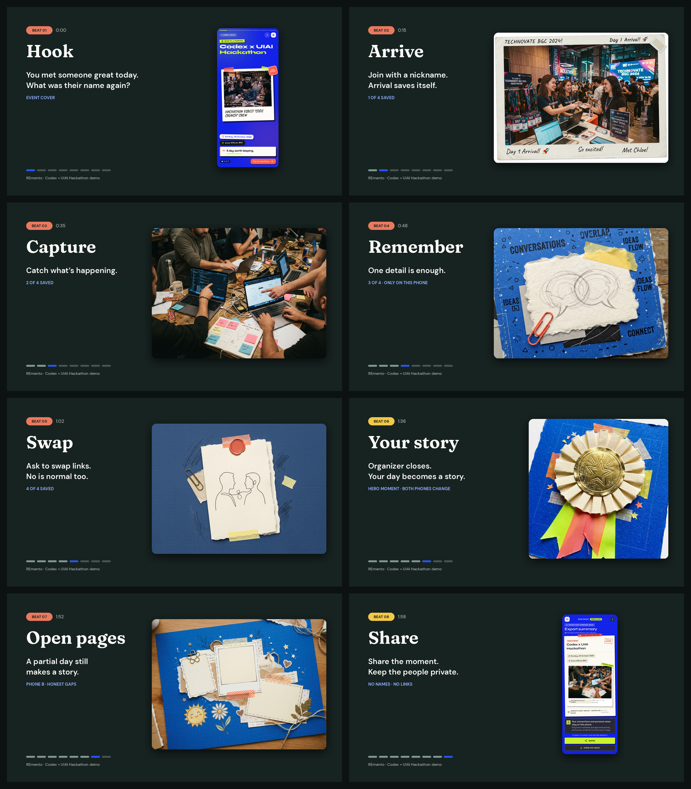

# Remento

### A good conversation deserves a second page.

The conversation ends. The event moves on. Later, the photo, the name, and the reason you wanted to reconnect sit in different places.

Remento keeps those pieces together while the day is happening: a scene, a detail about someone you met, and, with their permission, a way to reconnect. After the event, they come back as a private recap you can revisit or turn into a shareable image.

<p align="center">
  
</p>

<p align="center"><sub>Storyboard frames with illustrative sample content; these are not product screenshots or user research.</sub></p>

<p align="center"><a href="remento-story-demo.mp4">▶ Watch the Remento story demo</a></p>

## One event. Four small moments.

1. **Arrive.** Join with a nickname; your first page is ready.
2. **Catch a scene.** Save an activity photo from the day.
3. **Remember someone.** Keep a note, or an optional photo with their permission.
4. **Swap a way back.** Preview a person's shared links and save them only after you confirm.

After the organizer closes the event, Remento gathers what you saved into a short story. Missed a moment? The recap marks the gap with a gentle note, without turning the day into a scorecard.

The recap offers an optional event-style description: **Scene Catcher** for an activity photo, **Detail Keeper** for a person memory, and **Connector** for a confirmed exchange. With two or more traits, it adds the local label **All-Rounder**. The attendee must tap to request it. Remento sends OpenAI only whether each of those three signals was saved; it does not send photos, notes, names, profile links, or device IDs. Confidence values appear with each returned trait. The labels describe choices during this event, not personality.

## The recap is yours

Your photos, notes, and saved connections stay in this browser on this device. The organizer sees event settings, an in-app join count, and whether the event is open or closed. Your personal moments stay on your device.

The event-style request is optional and runs only after you tap its recap action. The server uses `OPENAI_API_KEY`; it does not store the signals or result. If no signals were saved, the recap explains that there is not enough information and makes no request.

Before you share, preview the summary image. It includes event details and the activity photo only if you choose it. Names, private notes, person photos, profile links, and QR data stay out.

## Try the prototype

[Open the hosted prototype](https://remento.vercel.app/) · The current deployment and two-phone flow still need a fresh check.

To run it locally:

```sh
npm install
cp .env.example .env.local
```

Add the Upstash Redis values, a private `ORGANIZER_TOKEN`, and `OPENAI_API_KEY` to `.env.local`, then start the app and API:

```sh
npm run dev
```

The attendee link is `/?event=codex-uiai-2026`. The organizer view uses `/?organize=<ORGANIZER_TOKEN>`; keep that link private. See [SETUP.md](SETUP.md) for database and deployment details.

## Built for the Codex x UIAI Hackathon

Remento is a Vite and TypeScript prototype. Redis holds shared event status and join records; attendee memories stay in browser storage. The interface supports QR exchange with manual link entry as a recovery path, and the recap works with both full and partial journeys.

The need is still a hypothesis. We have not yet checked with classmates how often they leave an event wishing they had kept a name, a detail, or a way to follow up. Local storage can be cleared, another device cannot recover a recap, and reminders appear only while the event page is open. Camera scanning and system sharing also depend on browser support; image download remains available.

### Project notes

- [Product brief and acceptance criteria](PRD.md)
- [Research and alternatives](RESEARCH.md)
- [Design brief](REMENTO-DESIGN.md)
- [Local and deployment setup](SETUP.md)
- [Recap mockups](mockups/README.md)
