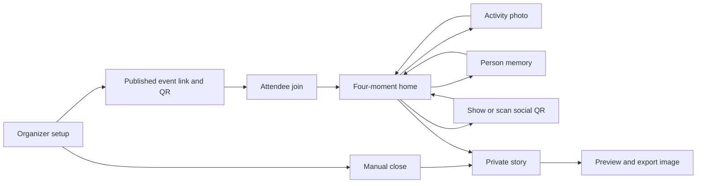

# REmento — candidate event design brief

**Status:** Selected Stage 1 prototype brief; implementation is in progress. Follow the reusable steps in [DESIGN.md](DESIGN.md). The audience is a student at a small campus event who wants to remember one person and how to reconnect. The organizer supplies a short shared event frame; the attendee owns their memory and contact data on their phone. Local demand remains unvalidated.

## Design question and success condition

Can a student, without coaching, join an event, capture a memory of someone met, exchange a contact route with consent, and later recognize that encounter in a private recap? Watch whether they can complete this during a real or simulated event without the phone taking over the conversation. A successful prototype run has both phones join, one consensual link saved, a partial recap still useful when a moment is missed, and an exported image that reveals no contact names or links by default. This tests usability only; local need remains an assumption.

The current workaround is the camera plus a social app and notes or contacts. [Mission Memories](https://www.missionmemories.app/about) already makes event photo missions and a recap; [Nalo Social](https://nalosocial.com/) already records scanned connections and a recap. The screen design must make the smaller personal task clear enough to justify opening another page.

## Information and navigation

The event has three phases: **join**, **during event**, and **after close**. The attendee's home is a vertical list of four moments, with current progress and one next action visible. Profile QR and saved connections live one tap from this home. The recap replaces the task list after the organizer closes the event, while a “My connections” action keeps saved contact links accessible on the same phone. Organizer screens are separate from attendee screens. Public join routes never expose organizer controls.

The transition from home to story occurs only when close status arrives or when a returning attendee opens an event already closed. Scheduled end time alone does not close the event. If the organizer closes while an attendee is editing, retain the local draft long enough to explain the close, then present the recap with content actually saved before close. Do not silently treat a draft as a completed moment.

## Screen and state contract

| Screen                        | Main content and action                                                                                                                                                                                                        | Empty or pending state                                                                                                                                                     | Error and recovery                                                                                                                                                                                          |
| ----------------------------- | ------------------------------------------------------------------------------------------------------------------------------------------------------------------------------------------------------------------------------ | -------------------------------------------------------------------------------------------------------------------------------------------------------------------------- | ----------------------------------------------------------------------------------------------------------------------------------------------------------------------------------------------------------- |
| **Organizer setup**     | Event name, date/time range, optional place; four fixed moment rows with editable label and cue time; publish action. Demo fixture loads the deck's Codex x UIAI Hackathon, 25 October 2026, 12:00–6:00 pm, Zone Offices BGC. | New organizer sees sensible moment labels and no invented attendee count. Unsaved changes are marked draft.                                                                | Missing name, invalid time range, or cue outside the event shows inline field error and keeps entered values. Publish failure leaves draft intact with retry.                                               |
| **Organizer live view** | Private organizer link, separate published attendee link/event QR, copy/share affordance, **in-app joins** count, close control. Close confirmation says attendees will see their recap and new joins will stop.         | Count starts at zero. QR has a visible text link under it for screen readers and print failure.                                                                            | Network failure labels count “Unable to refresh” instead of showing an old number as live. Close failure leaves event open and offers retry. Closed state shows time and disables further close attempts. |
| **Attendee join**       | Event name, schedule/place, nickname field, “Join event.” Arrival completes on successful join.                                                                                                                              | While joining, show a nonblocking progress label. A returning local attendee sees “Continue as [nickname]” and their saved progress.                                     | Invalid/closed link gives a clear message and route to enter a valid link. Network error keeps nickname and retries. Repeated join resumes the existing local record without another count.                 |
| **Moment home**         | Four ordered moment cards, each with label, short instruction, state, and action. Event progress uses “2 of 4 saved,” never a score. Profile QR and saved contacts are nearby but secondary.                                 | Before content, cards explain what counts. If no event data can load, show retry without erasing local entries.                                                            | Failed local save keeps the card incomplete and explains storage access or capacity. If close arrives, show “Event closed; see your story.”                                                               |
| **Activity photo**      | Camera or file picker, preview, replace/delete, save. Prompt uses an example such as food or a build table.                                                                                                                    | Blank camera area has both capture and choose-file paths. Canceled picker returns home incomplete.                                                                         | Denied camera shows file picker. Unsupported/oversized image offers another file. A photo is labeled “your snapshot,” never proof that an activity happened.                                              |
| **Person memory**       | “Who did you meet?” with a short text field for a memorable detail; optional photo with permission confirmation; save. The text path is complete without a photo.                                                            | Empty form explains “One detail you want to remember is enough.”                                                                                                         | Photo refusal returns to the text path without penalty. Empty text and no usable photo cannot save. Photo removal leaves text intact.                                                                       |
| **My social QR**        | Nickname and one or more labeled `https://` profile URLs; preview exact shared fields; generated combined QR with readable profile list.                                                                                     | No links yet: prompt “Add one link to make your QR.”                                                                                                                     | Invalid link/domain gets inline guidance. QR rendering failure still shows copyable links. User can remove a link before sharing.                                                                           |
| **Scan a QR**           | Request camera access on explicit tap, show scan frame and “Enter a link instead.” Decoded nickname and links appear in a confirmation sheet with host/domain and “Save connection.”                                       | No scan yet: explain that the other person must choose to share their QR.                                                                                                  | Denial, timeout, or unreadable QR provides manual link entry. Unsupported payload is rejected without navigating. A decline closes the sheet, saves nothing, and leaves moment 4 incomplete.                |
| **My connections**      | Locally saved nickname or user-added label, link hosts, optional private note, and open/copy actions.                                                                                                                          | “No connections saved yet” with a route to scan.                                                                                                                         | A broken or blocked external link stays visible with a copy option; deleting a contact requires confirmation and may return moment 4 to incomplete if it was the sole exchange before close.                |
| **In-app nudge**        | One small, dismissible banner names a due unfinished moment and opens it. Near close: “The event is wrapping up. Save anything you want to remember.”                                                                        | No banner if all due moments are complete or if the page is not open.                                                                                                      | If late after several cues, show only the most relevant unfinished action; dismissal is respected for that cue. No claim of push delivery.                                                                  |
| **Recap story**         | Event cover, available activity and person-memory panels, exchange summary (“You saved a way to reconnect”), and ending panel. Progress markers, “Previous”/“Next,” swipe, and “Export summary image.”                 | A missing moment receives an honest placeholder such as “No photo saved.” If all personal content is missing, show a minimal event card with the join and close context. | Media that cannot be read locally shows “Photo unavailable” and continues. An unexpected sync failure still allows a local recap after the attendee has received close status.                            |
| **Export preview**      | Exact summary image, “Download image,” and optional system share if supported. Activity image can be included; person image is off by default and requires deliberate inclusion.                                             | If no activity photo exists, generate a typographic event summary rather than a blank image.                                                                               | Export failure explains the issue and offers retry. Browser share failure falls back to download. Review the preview before either action.                                                                  |

## Four moment rules

1. **Arrival:** The completed state appears immediately after a successful join. The organizer may change its label and cue time, but no unfinished-arrival nudge can reach a person who has not joined; after join this moment is complete.
2. **Activity:** Require an actual saved image file. Do not infer what appears in it or claim that it proves attendance. Show “Replace” and “Delete” while the event is open.
3. **Person memory:** A text detail is enough. A photo is an optional alternative when the subject agrees; a text note can accompany it. The UI does not demand someone's legal name or make photography the default way to remember them.
4. **Reconnect:** The attendee can display their QR and can scan another attendee's. Only a confirmed saved link from the other person completes the moment. Scanning does not imply the other person scanned back. A refusal is normal, not an error or failure badge.

The organizer edits wording and cue times, not these completion rules. Changes end at publish for Stage 1 so every joined phone sees the same contract. The organizer sees count and close state but never moment completions, photos, contacts, or recap content.

## Visual direction: vibrant scrapbook

Use the feeling of a pocket event scrapbook: warm paper surfaces, saturated accent colors, cutout photo frames, a small set of sticker-like stamps for saved moments, and hand-placed composition in the recap. The **attendee home remains calm and readable**: one dominant next action, short labels, roomy touch targets, and clear incomplete/complete words beside any decorative stamp. The recap can carry more personality because users see it once after close.

- **Palette and type:** Choose an ink-dark text color on a warm light background, with a vivid cobalt or coral accent for actions and a second accent for scrapbook marks. Treat exact color values and typefaces as exploration choices; check contrast in the rendered prototype before settling them. Use a readable body face; a playful display face may appear in headings only.
- **Images:** Place the attendee's saved photo as the main visual, with a frame and date mark. Never fill a missing moment with a stock face or implied event photo. Sample images in a judge fixture must say “Sample.”
- **Hierarchy:** Event title and time orient the user; progress and the next moment lead; QR and connections remain easy to find without competing with the current task. On narrow phones, avoid horizontal card rows and clipped action labels.
- **Privacy cues:** “Only on this phone” appears near person notes and saved contacts, with a plain explanation that changing devices may lose them. Export preview visibly omits names and links. The QR preview lists everything another person can read before the attendee shows it.
- **Language:** Invitations, not achievement pressure. Use “Save a detail” and “Ask to swap links.” Avoid “prove,” “win,” “complete the set,” or a score. Partial recaps should feel valid.

Explore at least two layout variants before selecting a build direction: a **timeline** with moments as stops and a **scrapbook index** with photo-led entries. Compare how quickly a new attendee finds the next action and how much each layout asks them to scroll on a narrow phone. The recap may use the scrapbook composition even if the home uses the plainer timeline.

## Motion and direct manipulation

The reveal is the one place for a small celebratory transition: a page turn or short shared movement from the saved moment card into its recap panel can explain continuity. Keep it under a brief UI-scale duration and make it interruptible; the story must accept the next tap immediately. A completed moment may gain a quick stamp as feedback. Scanning feedback uses a still confirmation sheet rather than confetti. Repeated navigation and keyboard actions need no flourish. With reduced motion, swap the story panel instantly or with a gentle fade; every state remains named in text.

Swiping is optional. Previous/Next buttons, keyboard focus, and a visible panel count provide the same route. Back navigation should preserve the story position. Images need meaningful alternative text or user-provided context when the content matters; decorative tape and stamps stay out of the accessibility tree. Focus must return predictably after a QR confirmation or export sheet closes.

## Fixtures, checks, and next decision

| Fixture                    | Saved data                                                            | Expected visible result                                                                                                       |
| -------------------------- | --------------------------------------------------------------------- | ----------------------------------------------------------------------------------------------------------------------------- |
| Full journey on phone A    | Arrival, activity photo, text memory, confirmed scanned link.         | 4 of 4 saved; story uses the attendee's real media and note; connection remains private; export has no contact names or URLs. |
| Partial journey on phone B | Arrival and activity photo; person photo declined; exchange declined. | 2 of 4 saved; two honest gaps; usable event story and summary image; no shame language.                                       |
| Camera denied              | Join, no photo access, then file picker or text memory.               | Activity remains unfinished until a file is saved; person memory can complete as text.                                        |
| QR unreadable              | Another person's QR fails, then manual URL entry with permission.     | One validated URL can be confirmed and saved; unsupported text cannot complete the moment.                                    |
| Same-phone refresh         | Progress and a saved contact exist before refresh.                    | All local entries return; organizer join count does not rise.                                                                 |
| Organizer closes early     | At least one attendee has unfinished moments.                         | Joined phones see recap on next active update or refresh; new joins are rejected; unfinished content stays missing.           |

Before submission, check each fixture on two actual phones and on a narrow viewport. Inspect touch targets, keyboard order, visible focus, contrast, camera denial, QR recovery, storage failure, image download, and reduced motion. Ask classmates about a *recent* event connection before showing the prototype, then observe one uncoached attempt. Record what happened and compare it with the current workaround. The next product decision is whether those observations support continuing beyond the hackathon prototype.
